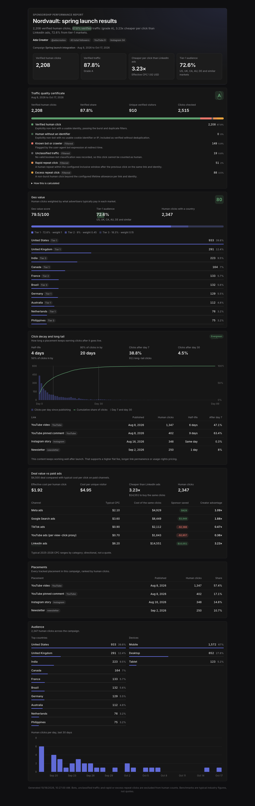
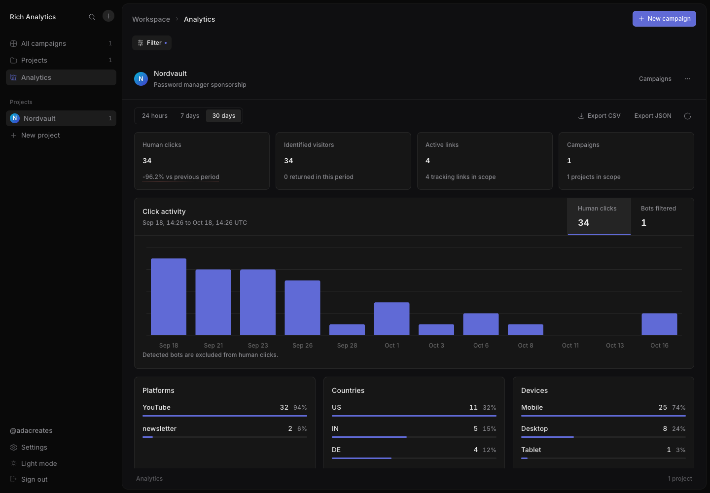
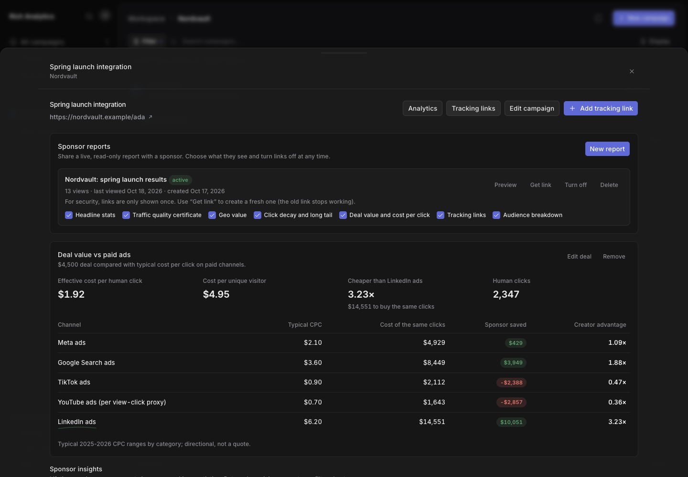

**RAT (Rich Analytics Tool)** is a self-hosted link tracking and campaign analytics system, originally built for freelance client work. It tracks how audiences engage with content across platforms, so creators and brands can see where their audience is most active, which placements drive real traffic and what that traffic is worth. Creators can then share the results with sponsors as a live report.

This open-source version is a generalized implementation. Fork it and build the analytics that matter most to your own clients.



## Features

- **Projects, campaigns and links:** organize work by client. Creating a campaign generates a tracking link for each of ten platforms, and you can add custom links by hand.
- **Short links with click tracking:** `GET /{slug}` redirects and records the time, country, device, OS, browser and referrer. Bots are flagged, and raw IPs can be purged on a retention schedule.
- **Analytics dashboard:** an interactive click-activity chart (human clicks vs filtered bots), human confidence, clicks per platform, global reach, platform efficiency, golden-hour heatmap, loyalty, device breakdown, velocity, network effect, hero campaign, monthly health and recent activity. You can view 24 hours, 7 days or 30 days, and export clicks as CSV or JSON.
- **Sponsor insights:**
  - **Traffic quality certificate:** an A–D grade based on the share of verified human clicks. Bots, unclassified traffic, rapid bursts and repeat clicks are counted separately.
  - **Geo value score:** weights clicks by each country's advertising value, so a click from a high-value market counts for more.
  - **Decay curve and long tail:** how clicks build up after a placement goes live, and how much traffic still arrives after day 7 and day 30.
  - **Deal value:** enter what a sponsor paid to see your effective cost per click compared with Meta, Google Search, TikTok, YouTube and LinkedIn ads.
- **Shareable sponsor reports:** create a read-only link at `/r/{token}` for a campaign. Choose which sections it shows, set an expiry, see view counts, and turn the link off or regenerate it at any time. Links are stored hashed and the page is never indexed by search engines.
- **Accounts:** email and password sign-in through Sanctum cookie sessions, a unique handle, and social profiles. Audience counts for YouTube, Instagram and Twitter / X are read from public pages, and there's an optional Twitch adapter.





## Tech stack

| Layer | Stack |
| --- | --- |
| API | Laravel 13, PHP 8.3+, MongoDB ([laravel-mongodb](https://github.com/mongodb/laravel-mongodb)), Sanctum (SPA cookie auth), Pest |
| Web | Next.js 16 (App Router, Cache Components), React 19, TypeScript |
| Data and forms | TanStack Query v5, React Hook Form, Zod 4 |
| UI | Tailwind CSS 4, shadcn/ui (Base UI) and shadcn charts (Recharts), Magic UI (Number Ticker, Highlighter), Hugeicons, Sonner |
| Tooling | Pint, ESLint, Prettier, Vitest, GitHub Actions, Laravel Boost |

```
api/      Laravel API + short links  → http://localhost:4000
web/      Next.js app                → http://localhost:3000
docs/     data contract, sponsor feature contract, IP retention runbook
```

The project is built on [Prism](https://github.com/jordansmalls/prism), a Next.js + Laravel starter kit.

## Quickstart

### Prerequisites

- PHP 8.3+ with the `mongodb` extension (`pecl install mongodb`), and [Composer](https://getcomposer.org)
- Node.js 22+ and [pnpm](https://pnpm.io)
- MongoDB 7+ running locally, a MongoDB Atlas cluster, **or** Docker to run the included `docker-compose.yml`

### 1. Get the code and start MongoDB

```bash
git clone https://github.com/jordansmalls/rat
cd rat
docker compose up -d   # optional: MongoDB on :27017 and Mailpit on :8025
```

### 2. Set up the API

```bash
cd api
cp .env.example .env
composer setup         # installs dependencies, generates APP_KEY and creates the MongoDB indexes
```

`.env.example` points at a local MongoDB (`MONGODB_URI=mongodb://127.0.0.1:27017`, database `rat`). To use Atlas, set `MONGODB_URI` and `MONGODB_DATABASE` instead.

### 3. Set up the web app

```bash
cd ../web
pnpm install
cp .env.example .env.local
```

### 4. Run it

```bash
cd ../api
composer dev
```

This starts the API on port 4000, a queue worker, the log viewer and the Next.js dev server on port 3000. Open **http://localhost:3000**, create an account, choose a handle and add your YouTube and Instagram accounts (Twitter and Twitch are optional).

To try the dashboard with sample data, add fictional projects, campaigns and clicks to your account:

```bash
php artisan rat:seed-demo --email=you@example.com
```

The command is additive and safe to rerun. Add `--dry-run` to see what it would insert.

### Ports and URLs

| Setting | Where | Default | Purpose |
| --- | --- | --- | --- |
| `SERVER_PORT`, `APP_URL` | `api/.env` | `4000` | Where the API runs |
| `BASE_URL` | `api/.env` | `http://localhost:4000` | Origin of generated short links (`BASE_URL/{slug}`) |
| `FRONTEND_URL` | `api/.env` | `http://localhost:3000` | CORS, email links, sponsor report links and the fallback for unknown short links |
| `API_URL` | `web/.env.local` | `http://localhost:4000` | Where Next.js proxies `/api/*` and `/sanctum/*` |

### Optional settings

- **Country lookup:** set `GEOIP_DATABASE` to the path of a MaxMind GeoLite2 City `.mmdb` file. Without it, clicks have no country, and the geo features show unknown.
- **Repeat-visitor tracking:** set `VISITOR_TRACKING_ENABLED=true` and a long random `VISITOR_SECRET`. This adds a signed first-party cookie, so repeat visitors are counted without relying on IPs.
- **Social counts:** counts refresh every `SOCIAL_REFRESH_MINUTES` (15 by default) while analytics is open, or on demand with **Refresh counts**. Saved counts stay visible when a provider fails.
- **Sponsor benchmarks:** paid-ad CPC benchmarks, exchange rates, geo tiers and the traffic-quality grade thresholds live in `api/config/sponsor.php`. The benchmarks are directional figures, so adjust them for your market.

## App routes

| Route | Description |
| --- | --- |
| `/dashboard` | Campaigns, projects and analytics in one workspace (`?view=projects`, `?view=analytics`) |
| `/projects/...` | Older project, campaign and link URLs, which redirect to the matching dashboard selection |
| `/settings` | Profile, email, handle, password and account deletion |
| `/login`, `/register`, `/forgot-password`, `/reset-password` | Account access |
| `/onboarding/username`, `/onboarding/socials` | Account setup |
| `/r/{token}` | Public sponsor report (no sign-in) |

In the dashboard, open a campaign and choose **Sponsor kit** to create share links, record the sponsor deal and see the campaign's sponsor insights. Project and link analytics include the same insights.

## API

All routes are under `/api/v1` and return JSON wrapped in `data`. Validation errors use Laravel's `422 { message, errors }` shape. A resource that belongs to another user returns `404`. Everything except auth, availability and public reports requires a signed-in user who has finished onboarding.

| Method | Path | Description |
| --- | --- | --- |
| POST | `/auth/register`, `/auth/login`, `/auth/logout` | Sessions (login accepts an email or a handle) |
| POST | `/auth/forgot-password`, `/auth/reset-password` | Password reset |
| GET, PATCH, DELETE | `/me` | Current user |
| PUT | `/me/username`, `/me/password` | Change the handle or password |
| PUT | `/onboarding/socials` | Save social profiles and finish onboarding |
| GET, POST | `/socials/counts`, `/socials/refresh` | Cached audience counts |
| GET, POST | `/projects` | List or create projects |
| GET, PUT, DELETE | `/projects/{project}` | A project |
| GET | `/projects/{project}/campaigns` | A project's campaigns |
| GET, POST | `/campaigns` | List or create campaigns (creating one generates ten platform links) |
| POST | `/campaigns/manual` | Add a custom link to a campaign |
| GET, PUT, DELETE | `/campaigns/{campaign}` | A campaign |
| GET | `/campaigns/{campaign}/links`, `/campaigns/{campaign}/performance` | Links and rolling performance |
| PUT, DELETE | `/campaigns/{campaign}/deal` | Record or remove what the sponsor paid |
| GET | `/analytics/overview` | Workspace totals (`window=24h\|7d\|30d`, optional `projectId`, `campaignId`, `linkId`) |
| GET | `/analytics/project/{projectId}/{metric}` | `human-confidence`, `clicks-per-platform`, `global-reach`, `efficiency`, `heatmap`, `loyalty`, `device-breakdown`, `recent-activity`, `platform-dominance`, `network-effect`, `velocity`, `hero-campaign`, `monthly-health` |
| GET | `/analytics/project/{projectId}/export` | Click export (`format=csv\|json`), as a file download |
| GET | `/analytics/project/{projectId}/{traffic-quality\|geo-value\|decay}` | Sponsor insights (optional `campaignId`, `linkId`; `decay` also takes `days`) |
| GET | `/analytics/campaign/{campaignId}/deal-value` | Effective CPC compared with paid ads |
| GET, POST | `/sponsor-reports` | List (`campaign_id=`) or create share links |
| GET, PATCH, DELETE | `/sponsor-reports/{report}` | Manage a report (`?preview=1` shows the sponsor's view without counting a view) |
| GET | `/public/reports/{token}` | Public report data (no auth, 60 requests a minute) |

Outside `/api`, `GET /{slug}` handles short-link redirects and `GET /up` is the health check. See [`docs/SPONSOR_FEATURES_CONTRACT.md`](docs/SPONSOR_FEATURES_CONTRACT.md) for the sponsor response shapes and [`docs/PORT_CONTRACT.md`](docs/PORT_CONTRACT.md) for the stored document shapes.

## Testing

```bash
# API: Pest tests run against a local MongoDB database (rat_api_testing), never against Atlas
cd api
php artisan test
vendor/bin/pint

# Web
cd web
pnpm lint && pnpm typecheck && pnpm test
pnpm format:check && pnpm build
```

CI (`.github/workflows/ci.yml`) runs these on every push and pull request with a MongoDB service container.

## Privacy and security

- Raw IP addresses are used for the country lookup and bot filtering. They are never returned by the API or included in exports. `php artisan rat:purge-raw-ips --retention-days=90` removes stored IPs from older clicks while keeping the clicks themselves. It's a dry run unless you pass `--apply`. See [`docs/ip-retention.md`](docs/ip-retention.md).
- Sessions use HTTP-only Sanctum cookies with CSRF protection. Auth endpoints and public reports are rate limited.
- Sponsor report tokens are stored as SHA-256 hashes, and the plain link is shown only once. Report pages send `Referrer-Policy: no-referrer` and `X-Robots-Tag: noindex`.

Before deploying beyond local use, run behind HTTPS, set `SESSION_SECURE_COOKIE=true` and `TRUSTED_PROXIES`, and make sure your data collection complies with the privacy laws in your region.

## Working with AI coding agents

`AGENTS.md` at the root, in `api/` and in `web/` describes the project's conventions, and `CLAUDE.md` points Claude Code at them. New API routes need a Form Request, an API Resource and a Pest test. New frontend features go in `web/src/features/<name>/`.

## License

MIT. See [LICENSE](LICENSE).
